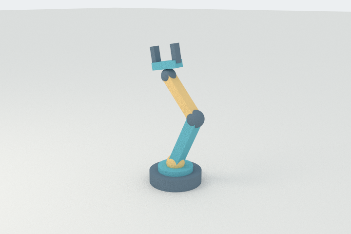
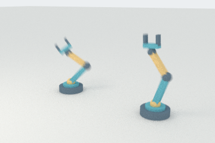

```{r setup, include=FALSE}
knitr::opts_chunk$set(collapse = TRUE, comment = "#>", out.width = "100%",
                     fig.align = "center")
knitr::read_chunk("scripts/model-animation.R")
```

An animated model combines reusable geometry with an internal animation, such
as a robot arm reaching or a bird flapping. Its placement in the scene is
independent: two copies can follow different paths and play the same clip at
different speeds.

This workflow builds an articulated inspection robot from rayrender primitives.
It uses all five model functions, queries poses without rendering, and renders
two independently animated copies. The five supplied images were rendered with
rayrender; the code that generates them is included below. Building this
vignette evaluates the model and pose examples but uses the supplied images.

| Function | What you supply | What you get |
|---|---|---|
| `animation_model_node()` | A part, its parent ID, and rest transform | One part of the hierarchy |
| `animation_model_clip()` | Named animation tracks targeting node IDs | A reusable internal motion |
| `animation_model_asset()` | The nodes and clips | A shared model definition |
| `animation_model_instance()` | An asset, outer path, and clip player | A scene object with its own placement and clock |
| `animation_model_pose()` | An instance and scene times | Evaluated transforms and morph weights for inspection |

These functions serve different workflows. Importing a GLB constructs its asset,
nodes, and clips for you; the last section shows that shorter route. The
unprefixed `model_*()` names have been removed. Use `animation_model_*()`.

```{r model-setup}
```

# Define parts around their joints

Our robot has a base, an upper arm, a forearm, and a gripper. Each moving part is
authored with its joint at its local origin. Its geometry extends along local
positive Y. This lets a rotation bend the part around the joint, instead of
spinning around the center of its geometry.

```{r model-geometry}
```

`animation_model_node()` gives a part a stable ID and attaches it to a parent.
The upper arm starts 0.32 units above the base. The forearm starts at the upper
arm's endpoint, 0.90 units along its local Y axis. The gripper similarly starts
at the end of the forearm.

```{r model-nodes}
```

The hierarchy is `base -> upper -> forearm -> gripper`. Moving the upper arm
carries its descendants along. Rotating the forearm leaves the upper arm alone.
The `transform` values above describe the **rest pose**, before a clip is selected.
Geometry's own static transforms remain inside these node transforms.

# Coordinate the joints with a clip

`animation_model_clip()` groups tracks into a named motion. Each name in
`channels` is a target node ID. The example uses rotation tracks with different
key schedules: the elbow does not have to change direction at the same time as
the shoulder. Angles are in degrees; key times are seconds within the clip.

```{r model-clip}
```

An animated property **replaces** that node's rest property. For example, the
upper arm's first animated rotation is -25 degrees, not an extra -25 degrees
added to its rest rotation. Missing properties retain their rest values, so
the joint offsets remain attached throughout the motion.

`"smooth"` interpolates rotations smoothly through interior keys. The first and
last poses here match, allowing repetition without a position jump. Matching
endpoint poses alone does not guarantee matching velocity at the loop seam.
All channels share the complete clip's two-second clock; shorter tracks would
hold their endpoint values until that clock wraps.

# Package the model once

`animation_model_asset()` assembles and validates the hierarchy and clip targets.
The resulting asset holds the source geometry, rest transforms, and animation
data for reuse. It does not itself place a robot in a scene.

```{r model-asset}
```

A default `animation_model_instance(robot)` uses the rest pose. It does not
automatically select the first available clip. Add a floor, a light, and a scene
camera to see the model before animation.

```{r model-rest}
```

```{r rest-figure, echo=FALSE, fig.cap="The authored rest pose. Blue and orange links meet at visible joints; the open gripper is a child of the forearm.", fig.alt="A three-dimensional blue and orange robot arm with a round base, articulated joints, and an open gripper, casting a shadow on a pale floor."}

```

# Place two copies on independent paths

These outer paths use **scene time**, not clip time. Each has four keys and its
own timing. Position uses cubic interpolation; orientation uses smooth rotation
interpolation. The bases slide and turn on the floor without changing the
joint animation.

```{r model-paths}
```

Both instances reference `robot`. The left robot plays `"reach"` at normal
speed. The right starts 0.7 seconds into that clip and plays at half speed.
`loop = "repeat"` repeats the internal clip; it does not wrap either outer path.

```{r model-instances}
```

Conceptually, each part's world transform is:

```text
outer placement(scene time) * parent transforms(clip time) * local pose(clip time)
```

Sharing an asset shares the model definition, not the instances' playback state.
Each instance can be placed, phased, or reversed independently. For a reversed
clip, use a negative player `speed` and an explicit `offset` selecting where to
start. A player speed of zero freezes its internal pose while its outer path
can continue moving.

# Inspect exact poses without a renderer

`animation_model_pose()` evaluates an instance at the supplied scene times in
any order. At scene time 1, the left robot uses clip time 1; the right uses
`0.5 * 1 + 0.7 = 1.2` seconds. Seeking backward does not accumulate transforms.

```{r model-inspect}
```

Each result contains:

- `local`: node transforms relative to their parents.
- `global`: composed node transforms in asset coordinates, excluding placement.
- `world`: composed transforms including the instance's outer placement.
- `clip_time` and `weights`: the selected local time and any morph weights.
- `placement_changed` and `pose_changed`: change flags relative to the previous
  requested result, useful for diagnostics.

The flags can depend on query order; the evaluated matrices do not. This is an
inspection function: it does **not** return a static scene or baked mesh. Use
`render_scene(time = ...)` to render a snapshot directly.

# Render requested scene times

The snapshot figures use a fixed camera, explicit scene times, CPU path tracing,
and a zero-width shutter. Run these chunks from the `vignettes` directory to regenerate
the supplied images. No Blender installation, downloaded asset, or Metal GPU is
required.

```{r model-render-settings}
```

```{r create-output, eval=FALSE}
dir.create("figures/model-animation", recursive = TRUE, showWarnings = FALSE)
```

```{r model-render-rest, eval=FALSE}
```

`render_animation()` takes the same scene and a vector of requested times. The
camera stored in the scene stays still. The returned images are in the order
of `times`, which may also be nonmonotonic.

```{r model-render-frames, eval=FALSE}
```

```{r pair-figures, echo=FALSE, out.width="49%", fig.show="hold", fig.cap="Scene times 0, 0.5, 1, and 1.5 seconds, in reading order. Each copy has its own base path and internal phase; the source asset is shared.", fig.alt=c("Two robot arms at scene time zero, with different joint poses.", "The same robots at half a second, moving and articulating independently.", "The robots at one second, with different elbow bends and gripper orientations.", "The robots at one and a half seconds, still sharing one asset while following different paths.")}
knitr::include_graphics(sprintf("figures/model-animation/pair-%02d.png", 1:4))
```

For a regular animation at 24 frames per second over four seconds, replace
`frame_times` with `(0:95) / 24`. Setting output cadence does not change the
clip's speed. A different ordering of those same times changes the output
ordering, not the poses evaluated at each time.

With `shutter_offsets = c(0, 0)`, each image is an exact-time snapshot. A nonzero
interval now integrates the full pose, including articulated nodes, skinning and
morphs. Each image sample evaluates the complete scene at one shutter time and
accumulates linear radiance before denoising and tone mapping. Existing mesh
buffers and BVH topology are retained; changing poses tight-refit the bounds.
The total ray budget remains `samples`. More samples improve temporal smoothness,
and adaptive stopping is disabled for full-pose exposures. To retain the old
frame-frozen internal pose, select `animation_motion_blur = "placement"`.

For a centered 1/8-second exposure on the CPU:

```r
render_animation(scene, times = (0:47) / 12, fps = 12,
                 width = 360, height = 240,
                 samples = 64, integrator_type = "nee",
                 shutter_offsets = c(-1, 1) / 16,
                 animation_motion_blur = "full")
```

The checkout's `dev/animation/render-native-full-pose-blur.R` produces a complete
48-frame CPU video using these settings (or a half-second exposure when requested).

```{r full-pose-result, echo=FALSE, out.width="70%"}

```

This 360 by 240 CPU preview uses 64 samples and a 1/8-second exposure; the
articulated links blur along with their independent outer paths.

# Preview the same scene

On a system with an interactive display, this opens the existing timeline UI.
Seek in either direction, play forward or backward, and adjust playback speed.
Pausing lets the selected time accumulate more samples.

```{r model-preview, eval=FALSE}
render_scene(scene, time = 0, timeline = c(0, 4), fps = 24,
             shutter_offsets = c(0, 0), preview = TRUE,
             width = 800, height = 600, samples = 256)
```

# Use an imported model instead

When a model is already authored in Blender or another tool, the importer
constructs the nodes, clips, and asset. You only need to select a clip and create
instances. This optional example requires your own `walk.glb` file:

```{r model-import, eval=FALSE}
walker = animation_read_gltf("walk.glb")
clips = animation_list_clips(walker)
clips
# Select the desired row's stable ID after inspecting the available clips.
walker_instance = animation_model_instance(
  walker,
  transform = left_path,
  animation = animation_clip_player(clips$id[1], loop = "repeat")
)
animation_model_pose(walker_instance, c(1, .25, 1))
```

Use the node, clip, and asset constructors when authoring articulated models in
R. Use the importer when those structures already exist in a file. Both routes
produce assets for the same instance, pose, preview, and rendering interfaces.

# Reproduce all five figures

From the repository root, with this version of rayrender installed:

```{r reproduce, eval=FALSE}
setwd("vignettes")
dir.create("figures/model-animation", recursive = TRUE, showWarnings = FALSE)
source("scripts/model-animation.R")
rmarkdown::render("model-animation.Rmd")
```

The script contains the same named chunks displayed here. Figure generation
does real path tracing; ordinary vignette builds reuse the PNG files and do not
launch rendering or a preview window.
